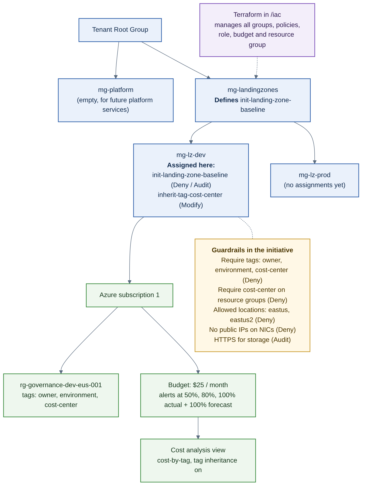

# J1: Azure Landing Zone Governance

Management groups, a policy initiative, tag inheritance and budget alerts, built in the portal, then brought under Terraform.

**Author:** William Crenshaw | **Last updated:** November 3, 2026

## Scenario

A small company needs separate dev and prod environments with guardrails so teams cannot deploy untagged, out-of-region or publicly exposed resources, and so spend is traceable to a budget. This project builds those guardrails once at the management group level and keeps them reproducible as code.

## Architecture



```
Tenant Root Group
├── mg-platform
└── mg-landingzones          <- init-landing-zone-baseline defined here
    ├── mg-lz-dev            <- initiative + tag inheritance assigned here
    │   └── Azure subscription 1
    └── mg-lz-prod
```

## What I built

- Management group hierarchy (`mg-platform`, `mg-landingzones`, `mg-lz-dev`, `mg-lz-prod`) with my subscription under `mg-lz-dev`
- Policy initiative `init-landing-zone-baseline` with seven policy references (table below)
- A separate Modify assignment that inherits the `cost-center` tag from the resource group, using a system-assigned managed identity with Contributor at `mg-lz-dev`
- A $25 monthly budget with alerts at 50%, 80% and 100% of actual spend and 100% of forecast
- A saved `cost-by-tag` view in Cost analysis, and tag inheritance turned on for cost data
- A permanent governance resource group, `rg-governance-dev-eus-001`, tagged to the standard
- All of it managed with Terraform in `/iac`, adopted from the existing resources with `import` blocks

## Policies

| Policy | Effect | Parameters | Why |
|---|---|---|---|
| Require a tag on resources (x3) | Deny | `owner`, `environment`, `cost-center` | Accountability and cost tracking |
| Require a tag on resource groups | Deny | `cost-center` | Makes sure the group has the tag that resources inherit |
| Allowed locations | Deny | `eastus`, `eastus2` | Data residency and spend control |
| Network interfaces should not have public IPs | Deny | none | Private by default |
| Secure transfer to storage accounts should be enabled | Audit | none | Require HTTPS for storage |
| Inherit a tag from the resource group if missing (separate assignment) | Modify | `cost-center` | Consistent tags without manual work |

Names and tags follow my [Naming and Tagging Standard](./NAMING-AND-TAGGING-STANDARD.md).

## Evidence

| What | Screenshot | What it shows |
|---|---|---|
| Compliance with a deliberate violation | `evidence/compliance.png` | 80% (4 of 5), one non-compliant storage account with HTTPS off |
| Denied resource group | `evidence/denied-rg.png` | Missing `cost-center` blocked, with my custom message |
| Denied storage account (no tags) | `evidence/denied-storage-no-tags.png` | Untagged resource blocked |
| Denied region | `evidence/denied-region.png` | Deployment to `westus` blocked |
| Denied NIC with public IP | `evidence/denied-nic-public-ip.png` | Public IP on a NIC blocked |
| Tag inheritance | `evidence/inherited-tag.png` | `cost-center` added to a resource that lacked it |
| Cost by tag | `evidence/cost-by-tag.png` | Spend grouped by `cost-center`, with the budget line |
| Budget alerts | `evidence/budget.png` | The four alert thresholds |
| Clean Terraform plan | `evidence/tf-plan-clean.png` | `No changes` after importing ten resources |
| Denial re-test from code | `evidence/tf-denied-rg.png` | The Terraform-managed policy blocks an untagged group |

## What broke and how I fixed it

1. **Policy tests failed with `SubscriptionNotFound`.** The subscription was fine; `Microsoft.Storage` wasn't registered. I registered the provider. A policy denial looks different (`RequestDisallowedByPolicy`), so the error code tells you which layer is blocking.
2. **The Modify policy's identity IDs didn't match.** IAM showed the client ID and the assignment showed the object ID. The role had already been granted, so I compared like with like.
3. **`az login` needed MFA** (`AADSTS50076`). `az login --tenant <id>` triggers the MFA prompt.
4. **Terraform wanted to destroy and recreate the initiative and two assignments.** I read the plan before applying. The causes were formatting, not substance: generated resource names, a missing empty `parameters`, a different policy reference order, and Azure storing IDs in lowercase. I matched each one until the plan showed no changes. Along the way, Terraform's `replace()` treated a search string with outer slashes as a regex and doubled them.
5. **Tag inheritance for cost data wasn't where I first looked.** At subscription scope it's under Settings > Manage subscription > Tag inheritance.

## Cost

Near zero. Policies and management groups are free. The budget is $25/month, and actual spend for this project was under $0.01 as of November 2, 2026 (a virtual network and public IP from the policy tests, since deleted).

## How I'd run this in production

- Roll new Deny policies out in Audit first, review the non-compliant list, then switch to Deny.
- Grant exceptions with policy exemptions that have an expiry date and an owner.
- Keep policy code in a repo with a pull request check that runs `terraform plan`.
- Use remote state in an Azure Storage account with locking, not a local state file.
- Assign baseline policies at a higher management group once proven in dev.
- Add policies for diagnostic settings to Log Analytics, a minimum TLS version (my test storage accounts defaulted to TLS 1.0), and required encryption.
- Move the initiative to `azurerm_management_group_policy_set_definition`, because `management_group_id` on `azurerm_policy_set_definition` is deprecated and goes away in AzureRM v5.
- Review compliance and exemptions monthly.

## Repo layout

```
j1-landing-zone/
├── README.md
├── NAMING-AND-TAGGING-STANDARD.md
├── iac/
│   ├── providers.tf
│   ├── variables.tf
│   ├── main.tf
│   ├── imports.tf          # one-time adoption of the portal-built resources
│   └── .terraform.lock.hcl
├── docs/
│   ├── session2-build-and-test.md
│   ├── session3-cost-governance.md
│   └── session4-terraform.md
└── evidence/
```

State and plan files are not committed. The subscription ID and owner email are passed with `TF_VAR_...` variables.

## Resume bullet

Designed and deployed an Azure landing zone governance baseline: a four-group management group hierarchy, a seven-policy initiative enforcing required tags, approved regions and no public NIC IPs, tag inheritance via a Modify policy, and budget alerts; imported the portal build into Terraform and reconciled it to a zero-diff plan.

## Interview story (90 seconds)

**Situation:** A small company needed dev and prod separation with guardrails so nobody could deploy untagged, out-of-region or publicly exposed resources.

**What I built:** Management groups, a policy initiative at the landing zones level assigned to dev, a Modify policy so resources inherit the cost-center tag from their resource group, and a budget with early and forecast alerts. I tested each guardrail with a deliberate violation, then brought it all under Terraform.

**What broke:** When I imported the portal build, the first plans wanted to destroy and recreate the initiative and its assignments. I read the plan before applying and found the causes were generated names, ordering and Azure storing paths in lowercase, so I matched them until the plan showed no changes.

**What I'd do differently:** Start in Audit before Deny, use policy exemptions with an expiry, put the code in a pipeline that runs a plan on every pull request, and use remote state with locking.
